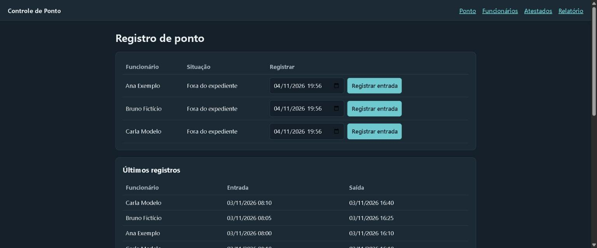
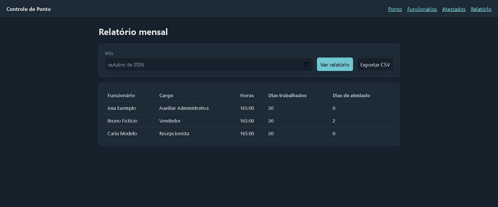

# Controle de Ponto

Sistema web para registrar entradas e saídas, guardar atestados e gerar o relatório mensal de horas.



## Problema

Em empresas pequenas, o ponto e os atestados costumam ficar em papéis e planilhas separados. No fechamento do mês, isso dá trabalho e aumenta o risco de erro na conferência das horas.

## Funcionalidades

- Cadastro, edição e desativação de funcionários.
- Registro de entrada e saída.
- Bloqueio de saída sem entrada aberta e de duas entradas abertas ao mesmo tempo.
- Registro de atestados.
- Relatório mensal com horas, dias trabalhados e dias de atestado.
- Exportação do relatório em CSV.
- Script para gerar dados fictícios.

## Decisões do projeto

- **Regras separadas:** os cálculos ficam em `regras.py`, sem depender do banco nem da tela, o que facilita os testes.
- **Proteção no banco:** um índice único impede dois registros abertos para o mesmo funcionário.
- **Consultas parametrizadas:** os valores enviados não são colocados diretamente no SQL.
- **Desativar em vez de excluir:** o histórico do funcionário continua disponível para os relatórios.

## Tecnologias

Python, Flask, SQLite, HTML, CSS e `unittest`.

## Como rodar

```bash
python -m venv .venv
.venv\Scripts\activate
pip install -r requirements.txt
python seed.py
python app.py
```

Depois, abra `http://127.0.0.1:5000`. No Linux ou macOS, ative o ambiente com `source .venv/bin/activate`.

## Testes

```bash
python -m unittest discover -s tests
```

## Limitações

O projeto foi feito para rodar localmente e não tem login. Antes de usar com dados reais, seria preciso adicionar autenticação, proteção contra CSRF e hospedagem segura. Todos os dados de exemplo são fictícios.

## Relatório mensal


